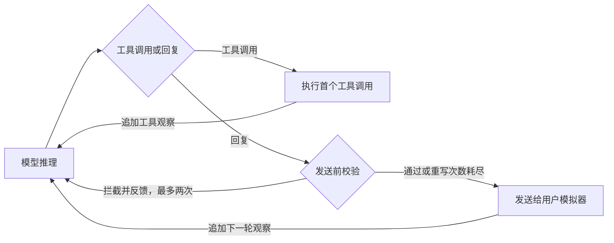

# Lean Agent Runtime

客服 Agent 完成了退款或改配，仍可能在回复里把支付方式 ID 当成银行卡末四位。给回复加一层校验能捕获这类错误，但把校验扩展到退款金额、商品属性和订单关系后，也可能拦住本来正确的话。我基于 nanocode 的循环思路实现了一个轻量级单 Agent Runtime，用 τ-bench 零售任务分别测量**业务任务是否完成、错误是否发给客户、护栏为此多花了多少次调用**。

[护栏实验报告](docs/results/f1_20261102_011103/summary.md) · [运行时架构](#运行时架构) · [快速开始](#快速开始与实验复现) · [发布来源](docs/release-provenance.md)

| 工程问题 | 观察结果 |
|---|---|
| 发送前核对能减少卡号混用吗？ | 50 道测试任务各跑 3 次，无护栏组有 **4/150（2.7%）** 条轨迹出现混用，只开支付护栏的组为 **0/150**。 |
| 更宽的事实检查值得默认开启吗？ | 开发池的 **1,569 条可判字段断言**中未发现确定错误，测试中的 **3 次拦截全是误拦**。本地 API 默认只开启支付护栏。 |

## 运行时架构



- **轻量循环。** `ModelClient`、`ToolProvider` 和 `Environment` 分离推理、工具执行和环境状态。每轮沿用 τ-bench 参考 Agent 的单工具语义。单条运行分别限制步数、模型调用次数、token 和墙钟时间。[运行循环](runtime/agent.py) · [接口定义](runtime/protocols.py)
- **可回溯执行。** 每次运行保存消息历史、JSONL Trace、结束状态和评分前快照。Trace 把工具观察、被拦回复、重写结果及用户可见文本分开，方便判断错误是否真正发出。[轨迹样本](docs/results/f1_20261102_011103/payment_guard_r01_test_059/trace.jsonl)
- **零售基准适配。** 适配器按任务索引初始化环境，向模型提供政策、工具及观察，评分侧单独持有标准答案。τ-bench 的评分函数会重置并重放标准动作，因此我在调用它之前保存实际动作和终态，避免把标准动作误读成 Agent 行为。[零售适配器](domains/tau/adapter.py)

## 受控评测与预算

Git submodule 固定 nanocode 和 τ-bench 的源码版本。用固定种子生成任务清单并校验开发池与留出测试集。实验锁定 Agent 与模拟器的模型版本及温度，记录配置、政策和实现版本。模拟器补丁只负责传递温度和累加费用，评分沿用上游实现。[任务清单](configs/task_manifest.json) · [模拟器补丁](patches/tau_user_simulator.patch)

开发池用于确定护栏，留出集比较**无护栏、仅支付护栏、支付与通用事实护栏同时开启**三组。三组共 450 次运行，采用相同任务和试次编号。业务任务用 τ-bench reward 衡量，回复质量单独统计用户可见错误和误拦。三组业务分数的差异按运行波动处理。[完整实验](docs/results/f1_20261102_011103/summary.md) · [基线失败诊断](docs/results/f1_20261102_011103/failure_diagnosis.md)

成本按缓存命中输入、未命中输入和输出 token 分项折算，缺少用量的请求单列。五题试点采用 **¥30 折算预算**，正式三组对照采用 **¥15 调度预算**。批次在达到调度阈值后停止发起后续任务，单次运行仍受自己的资源上限约束。[运行器](eval/runner.py) · [成本记录](docs/results/f1_20261102_011103/summary.md#b-基础设施与费用)

## 输出护栏消融（Guardrail Ablation）

| 测试配置 | 卡号混用轨迹 | 误拦消息 | 单次任务成功率 | 三次全成功率 |
|---|---:|---:|---:|---:|
| 无护栏 | 4/150 | 0 | 83.33% | 70.00% |
| 仅支付护栏 | 0/150 | 0 | 84.00% | 72.00% |
| 支付与通用事实护栏 | 0/150 | 3 | 87.33% | 76.00% |

**支付卡号校验适合窄域拦截。** 工具返回的付款方式 ID 与银行卡末四位是不同字段，校验可以用已有观察确认冲突。若工具尚未提供末四位，反馈要求模型查证或明确标注付款方式 ID。无护栏组的 4 条错误轨迹共含 5 次混用。支付护栏组拦下 2 条回复，额外调用模型 2 次。组合组抽取的 10 条银行卡相关轨迹经过独立核对，结果均与自动检查一致。[支付校验实现](domains/tau/payment_hook.py) · [拦截与开销](docs/results/f1_20261102_011103/summary.md#c-拦截与额外开销)

**通用事实校验的难点在于绑定语义。** 金额本身可以精确计算，先要知道用户说的是整单、某件商品、退款额还是改配差价。例如，笔记本改配应退 **181.37**，校验器却把回复绑定到 **5,657.06** 的整单退款。另两次误拦也来自选错了商品范围。组合组拦下 5 条消息，其中 3 次误拦来自通用事实校验，整组额外产生 7 次 HTTP 尝试。这个结果让我把默认拦截范围收回到证据能明确对应的支付字段。[通用事实校验实现](domains/tau/fact_hook.py) · [三条误拦原文与计算依据](docs/results/f1_20261102_011103/fact_block_review.json)

两个护栏共享每次发送前**最多两次反馈重写**。预算耗尽后，系统发送当前回复并记录告警。这让纠正机会、误拦代价和额外模型调用都能从 Trace 中计量。

## Prompt Caching 观测

我按原顺序重放同一零售任务的 12 个已保存请求，每次使用原始消息和工具定义作为输入。历史双凭据记录与共享凭据重放的输入各为 **37,164 token**，缓存命中占比分别为 **79.91%** 和 **98.16%**，重放组的输入折算费用比历史记录低 **82.47%**。这组数据用于观察缓存表现。要判断凭据策略本身的收益，还需要在相同预热状态、请求时点和节奏下对照。[请求重放与成本明细](docs/results/cache_probe_20261029_225303/comparison.md)

## 本地 API 服务

FastAPI 将已登记的开发任务排入单工作线程，统一执行请求节流和预算检查。SQLite 在同一事务里登记幂等键和运行记录。相同键和相同请求返回同一 `run_id`，相同键与不同请求返回 HTTP 409。客户端用运行 ID 查询状态、reward 和 Trace。[API 实现](service/app.py) · [幂等存储](runtime/store.py)

## 快速开始与实验复现

### 1. 初始化环境并运行离线测试

在仓库根目录运行以下命令。使用 Python 3.12，创建虚拟环境后先激活它。macOS 或 Linux 使用 `source .venv/bin/activate`，Windows PowerShell 使用 `./.venv/Scripts/Activate.ps1`。

```bash
git submodule update --init --recursive
python -m venv .venv
# 此处激活虚拟环境
python -m pip install -r requirements.lock.txt
python -m pip install --no-deps -e .
python -m pip install --no-deps -e vendor/tau-bench
python -m scripts.m0 prepare
python -m pytest -q
```

准备命令校验上游版本、应用模拟器补丁并生成任务清单。离线测试无需模型凭据。

### 2. 启动 API 并查看运行轨迹

此节和下方在线实验使用自己的模型凭据，并消耗模型额度。

将 `.env.example` 复制为 `.env`，填入 `ARK_AGENT_API_KEY` 和 `ARK_USER_API_KEY`。启动服务后可在浏览器打开 [Swagger UI](http://127.0.0.1:8000/docs)。

```bash
python -m uvicorn service.app:app --host 127.0.0.1 --port 8000
```

另开一个终端发起请求。以下使用 Bash 语法，也可在 Swagger UI 提交同样的请求。

```bash
curl -X POST http://127.0.0.1:8000/runs \
  -H 'Content-Type: application/json' \
  -H 'Idempotency-Key: retail-dev-4-payment' \
  -d '{"task_ref":{"domain":"retail","split":"dev","index":4},"variant":"payment_guard"}'
```

将返回的 ID 代入 `GET /runs/{run_id}` 查询状态与评分，或请求 `GET /runs/{run_id}/trace` 查看结构化事件。运行产物保存在 `outputs/service/`。

### 3. 按实验目的运行命令

以下命令通过 `--live` 发起在线请求。默认实验配置使用 `deepseek-v4.1-flash`。

| 用途 | 命令 | 运行范围 |
|---|---|---|
| 估算成本 | `python -m scripts.m0 pilot --live` | 5 道开发任务各跑一次参考 Agent，记录两路 token 用量。 |
| 跑通运行时 | `python -m scripts.m1 --live --smoke` | 运行 1 道开发任务，查看完整消息、Trace 和评分。 |
| 对比开发池护栏 | `python -m scripts.m1 --live --config configs/m1_payment_guard.json` | 使用固定开发池。配置文件也可选 `m1_baseline.json`、`m1_fact_guard.json` 或 `m1_all_guards.json`，分别对应无护栏、仅通用事实校验和两种护栏同时开启。 |
| 重放缓存请求 | `python -m scripts.cache_probe --live` | 重放仓库已保存的 12 个请求，另需 `ARK_CACHE_TEST_API_KEY`。 |

评测批次写入 `docs/results/`。发布包提供精选轨迹和紧凑评分数据，可直接离线复算三组 pass 指标。

```bash
python -m eval.release_metrics
```

原实验批次使用 `scripts.f1` 校验冻结实现提交、策略和任务清单。该校验依赖原项目的 Git 历史。公开版提供上表中的在线小样和开发池入口，以及历史批次的离线评分复算。[发布来源](docs/release-provenance.md)

## 第三方来源

项目自有代码遵循 [MIT License](LICENSE)，第三方组件各自遵循上游声明。

- [nanocode](https://github.com/1rgs/nanocode) 固定在 `b009d3dbedf14795a5c10804a5455386563f4b5b`，作为运行循环设计的参考。上游 README 标注 MIT，该提交没有单独的 LICENSE 文件。公开仓库通过子模块引用上游。
- [τ-bench](https://github.com/sierra-research/tau-bench) 固定在 `59a200c6d575d595120f1cb70fea53cef0632f6b`，上游 [MIT LICENSE](vendor/tau-bench/LICENSE) 随子模块保留。`scripts.m0 prepare` 应用[模拟器补丁](patches/tau_user_simulator.patch)，传递温度并累计费用。
